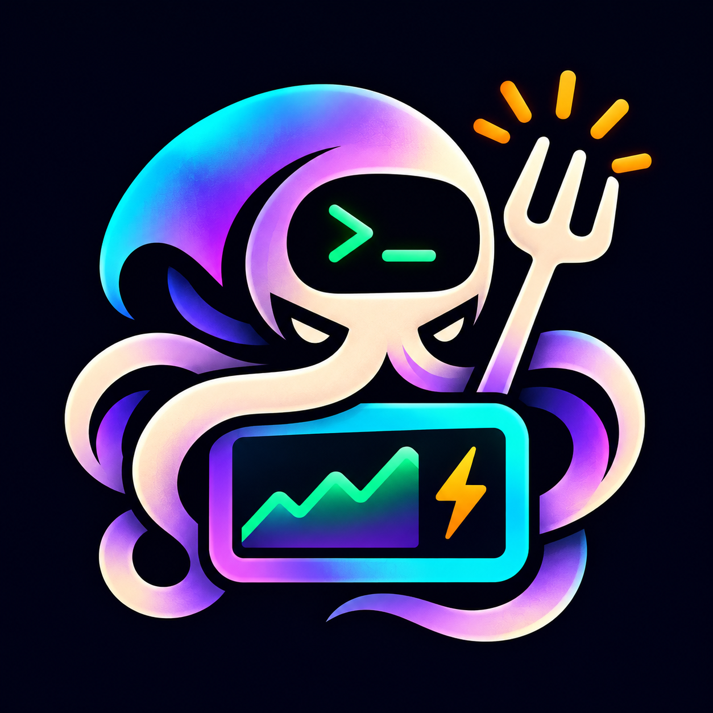

<p align="center">
  
</p>

<h1 align="center">Forkcast</h1>

<p align="center">
  A low-overhead macOS menu bar monitor for machines that run long jobs.<br>
  Power vs the charger, CPU, memory, disk, network, and your jobs' progress, all on one page,<br>
  with a <code>forkcast</code> CLI and a local JSON API for scripts and AI agents.
</p>

---

Forkcast answers two questions:

1. **Is the machine safe?** Is the charger keeping up, is the disk filling, is memory under pressure, is the Mac throttling?
2. **Is my work progressing, and can I add more?** Which jobs are running, how far along they are, when they'll finish, and whether there's room for another.

It was built for people (and agents) who leave renders, analyses, uploads or other batch jobs running for hours or days on a laptop.

## Features

- **Power you can trust.** Real CPU, GPU and memory/SoC power from the chip's energy counters (the same source `powermetrics` uses), without sudo. Total draw, charger watts, and **net battery flow**: + into the battery, − out of it. That catches the case where macOS says "charging" while the percentage falls. Per-process power adds up to the measured total.
- **Grouped by job, not by app.** Everything you start from a terminal is grouped under the job that started it, not lumped into "Terminal". Rows are labelled from the command line, for example `python3 render_scenes.py batch7`. Short-lived child processes are credited to their parent's job. Spotlight, WindowServer and other system work get their own named rows.
- **Resource tiles** with 24-hour sparklines:
  - CPU: P and E cores, thermal state, throttling.
  - Memory: pressure, swap and swap growth.
  - Disk: free space now (the same figure as `df`), plus macOS' "incl. purgeable" estimate, trend (one-off cleanups are logged as events and left out of the rate), time until a floor, Time Machine local snapshots, and an alert when deleting files doesn't free space because snapshots are holding it.
  - Also external drives, network, disk I/O and watched folders.
- **Job registry.** Start jobs with `forkcast run`, or register running ones. Progress can come from explicit calls, a log file or heartbeats, and a total or log rule can be added to a running job later. You get rates, ETAs, staleness detection, exit codes, queued jobs (`--after JOB|PID`), a `waiting` state for chained lanes, and per-group ETAs (a lower bound when some jobs have no total). Re-using a name starts a new run; earlier runs stay in its history.
- **Headroom.** Free cores (p90), memory before pressure, power margin under the charger. A cost card per kind of job, and an estimate of how many more fit, with the bottleneck and a confidence level.
- **Alerts and guards:**
  - Alerts for the charger being unplugged or under-powered, the battery draining on AC, low disk or time-to-floor, memory pressure, swap growth, throttling, unmounted drives, stale or ended jobs, crash reports, a background job opening a window, and CPU above or below an expected range.
  - Guards can pause or resume a job group automatically (SIGSTOP/SIGCONT on its whole process tree).
  - Delivery by notification, webhook or shell command.
- **Timeline and history.** Every plug, sleep, alert, guard action and job event, plus stacked charts on a shared time axis with a crosshair and drag-to-inspect. Kept for 30 days in SQLite and written immediately, so it survives crashes and power loss.
- **For scripts and agents.** `forkcast wait 'job batch7 done or battery < 15'` replaces polling loops. Every read command takes `--json`. `forkcast help --json` describes the whole CLI.
- **Light on the machine.** About 0.25% CPU and 25 MB of memory in the background (it samples every 10 s). It samples every 1 s while a window is open.

## Requirements

- macOS 14 (Sonoma) or later on **Apple Silicon** (the energy counters it reads are Apple Silicon only)
- Xcode 15.3+ or the matching Command Line Tools (Swift 5.10), to build from source

## Install

### Download (recommended)

Get **Forkcast-&lt;version&gt;-macos-arm64.pkg** from [Releases](https://github.com/josephvolmer/forkcast/releases/latest) and double-click it. The installer:
- puts `Forkcast.app` in `/Applications`;
- links the `forkcast` command into `/usr/local/bin` (already on your `PATH`);
- links its man page;
- starts the app.

The local API is part of the app, so there's nothing else to install.

If a release isn't notarized, macOS will say it can't verify the installer. Right-click the `.pkg` and choose **Open**, or use **System Settings › Privacy & Security › Open Anyway**. No admin rights? Use the `.zip` from the same release and run `sh install.sh` from the unzipped folder.

### From source

```sh
git clone https://github.com/josephvolmer/forkcast.git
cd forkcast
make install
```

This builds the app, installs it to `/Applications/Forkcast.app`, links the CLI to `~/.local/bin/forkcast` and the man page to `~/.local/share/man/man1/forkcast.1`, and launches it. A fork icon appears in the menu bar. Make sure `~/.local/bin` is on your `PATH`.

| Command | What it does |
|---|---|
| `make` | build `./build/Forkcast.app` (regenerates icons from `icon.png` / `fork.png` when they change) |
| `make install` | install and launch (override with `APPS_DIR=… BIN_DIR=… MAN_DIR=…`) |
| `make pkg` | build a double-click installer, `build/Forkcast-<version>.pkg` |
| `make run` | build and open the dashboard without installing |
| `make check` | build, then smoke-test the CLI and its documentation |
| `make uninstall` | remove the app, CLI link and man page (keeps your data) |
| `make clean` | remove build products |

The app is ad-hoc signed when built locally. To start it at login, tick **Open at login** in the dashboard.

## Using it

- **Menu bar:** click the fork for a compact view (battery and net flow, headroom verdict, alerts, jobs, top power users).
- **Dashboard:** open Forkcast again from Spotlight or Finder, click **Open dashboard** (⌘D), or run `forkcast open`.
  - **Header tiles:** hover any figure for its data source and sample age.
  - **Left panel:** jobs and process groups. Click a row for its processes and command lines.
  - **Right panel:** history charts. Drag across them to see what used the energy in that window.
  - **Bottom panel:** alerts, timeline and guards.
- **Copy as JSON:** the `{}` button on every panel copies its data.

## Command line

```sh
forkcast status                         # power, CPU, memory, disk, network, headroom, alerts, top groups, jobs
forkcast ps [--sort cpu] [--by tree]    # processes grouped by job / app / tree
forkcast headroom                       # can I add more? cost cards + estimate + bottleneck
forkcast events --since 8h              # the timeline
forkcast changes --since 3h             # jobs started / finished / failed / stale since then

# Jobs
forkcast run --name batch7 --group renders --log render.log --total 1721 -- ./render.sh batch7
forkcast run --name batch8 --group renders --after batch7 -- ./render.sh batch8   # queued
forkcast register --name ghidra --group analysis --pid 4242 --stale 3h
forkcast progress batch7 412/1721
forkcast progress batch7 --total 1721           # set a total later, no restart
forkcast state lane2 waiting --on lane1         # chained lane: not stale, not in cost cards
forkcast jobs
forkcast eta                            # per-group ETA, with its basis

# Wait instead of polling (exit 0 met · 124 timeout · 2 bad expression)
forkcast wait 'job batch7 done or battery < 15' --timeout 6h
forkcast wait 'pid 12345 exits'
forkcast wait 'file ~/out/done.flag exists'

# Pause / resume and guards
forkcast pause renders
forkcast guard add --name drain --when 'net_battery_w < 0 and on_ac' --for 10m \
                   --action pause --group renders --resume-when 'battery > 30'
```

The CLI documents itself:

```sh
forkcast help                 # every command
forkcast <command> --help     # options, examples and exit codes
forkcast help expressions     # the condition language used by wait and guards
forkcast help agents          # recommended workflow for scripts and AI agents
forkcast help api             # the HTTP API
forkcast help --json          # the whole CLI as JSON
man forkcast
```

If the app isn't running, the CLI starts it. Unknown commands and options are rejected with exit code 2.

### Condition expressions

```
battery > 25                         on_ac and net_battery_w > 0
disk_free_gb < 50                    mem_pressure == red
job batch7 done                      group renders idle
pid 12345 exits                      file ~/out/done.flag exists
process_running('installer')         not (a or b) and c
```

Run `forkcast metrics` for every metric name.

## HTTP API

The CLI is a thin client of a local HTTP API on `127.0.0.1:47215`. It listens on the loopback interface only.

- `GET` requests need no token.
- `POST` and `DELETE` need `Authorization: Bearer <token>`. The port and token are stored in `~/Library/Application Support/Forkcast/api.json` (mode 600).
- Requests with a browser `Origin` header, or a non-localhost `Host`, are refused. This blocks web pages and DNS rebinding.

```sh
curl -s 127.0.0.1:47215/status | jq .power
```

Endpoints:
- **Status and processes:** `/status`, `/processes?group_by=job|app|tree`, `/headroom`
- **Jobs:** `/jobs`, `/jobs/<name>`, `/groups/<g>/eta`
- **Timeline:** `/events?since=1h`, `/changes?since=…`
- **Waiting and guards:** `/wait?until=<expr>&timeout=3h`, `/guards`
- **History:** `/history?metric=draw_w&range=24h&step=5m`
- **Writes:** register, progress, beat, exit, pause/resume, guards

See `forkcast help api` for the full list.

## Configuration

`~/Library/Application Support/Forkcast/config.json` is created on first run. It's reloaded when saved, and missing keys use defaults. It holds:
- alert thresholds
- guards
- label rules
- container names (for example agent CLIs whose children should become separate jobs)
- the disk floor
- watched volumes and folders
- sampling intervals
- delivery settings (notification, webhook, or shell command, per alert type)

Most of these can also be edited under **Alert settings…** in the dashboard.

Example label rule, which turns `python3 render_scenes.py batch7 …` into a row named `render scenes · batch7`:

```json
"labelRules": [
  { "match": { "exe": "python3*", "arg_regex": "render_(\\w+)\\.py (\\S+)" }, "label": "render {1} · {2}", "kind": "render {1}" }
]
```

## How it measures

| Figure | Source (no root needed) |
|---|---|
| CPU, GPU, Neural Engine, DRAM/SoC power | IOReport "Energy Model" counters |
| Total draw, charger watts, net battery flow | AppleSmartBattery (IOKit): system load, adapter details, voltage × current |
| Per-process power and CPU | one `sysctl(KERN_PROC_ALL)` per sample + `proc_pid_rusage` (energy, CPU, disk I/O, reaped-children CPU), scaled to the measured CPU power |
| Other users' processes (Spotlight, WindowServer, daemons) | the setuid `/bin/ps`, every 15–60 s |
| CPU load, thermal state | per-core tick counters, `ProcessInfo.thermalState` |
| Memory | `host_statistics64`, memory-pressure level, `vm.swapusage` |
| Disk | volume capacities (including purgeable), `tmutil` local snapshots, block-device byte counters |
| Network | interface counters; top process via `nettop` only while a window or the API is in use |

Notes:
- **What can't be named.** Power that can't be pinned on a specific process (the kernel, and processes that start and exit between samples without being reaped by a process Forkcast can read) appears as "Kernel, system & short-lived processes". All rows add up to the measured total.
- **"Display & other"** is total draw minus everything the chip measures: backlight, SSD, Wi-Fi, audio and power-conversion losses.
- **Memory** is the physical footprint, as in Activity Monitor. Hover a process for its resident size.

## Privacy

Everything stays on your Mac. Forkcast makes no network connections of its own: no telemetry and no update checks. The only exception is a webhook URL you configure yourself for alerts. History lives in `~/Library/Application Support/Forkcast/` and is pruned after 30 days.

## Uninstall

```sh
make uninstall                                          # if installed from source
sudo rm -rf /Applications/Forkcast.app /usr/local/bin/forkcast /usr/local/share/man/man1/forkcast.1   # if installed with the .pkg
rm -rf ~/Library/Application\ Support/Forkcast          # history, settings, API token
```

## Releases

Pushing a tag (`git tag v2.1.0 && git push origin v2.1.0`) runs [the release workflow](.github/workflows/release.yml). It builds on an Apple Silicon runner, runs `make check`, and publishes a GitHub Release with the `.pkg`, a `.zip` (app + `install.sh`) and `SHA256SUMS.txt`. It can also be started from the Actions tab; leave the version empty for a test build that isn't published.

Builds are ad-hoc signed by default. To ship Developer ID-signed, notarized builds, add these repository secrets:

| Secret | Contents |
|---|---|
| `MACOS_CERTIFICATE_P12_BASE64` | base64 of a .p12 holding your *Developer ID Application* and *Developer ID Installer* certificates |
| `MACOS_CERTIFICATE_PASSWORD` | the .p12 password |
| `MACOS_SIGNING_IDENTITY` | e.g. `Developer ID Application: Your Name (TEAMID)` |
| `MACOS_INSTALLER_IDENTITY` | e.g. `Developer ID Installer: Your Name (TEAMID)` |
| `NOTARY_APPLE_ID`, `NOTARY_TEAM_ID`, `NOTARY_APP_SPECIFIC_PASSWORD` | credentials for `notarytool` |

## Project layout

```
Sources/ForkcastCore/   shared JSON models (the API schema) and the expression language
Sources/Forkcast/       the app: sensors, process grouping, jobs, alerts, guards, headroom, storage, API server, SwiftUI
Sources/ForkcastCLI/    the `forkcast` command; Help.swift generates --help, help --json and the man page
scripts/make-icon.swift builds AppIcon.icns from icon.png
Makefile                build / install / check
```

## License

[MIT](LICENSE)
